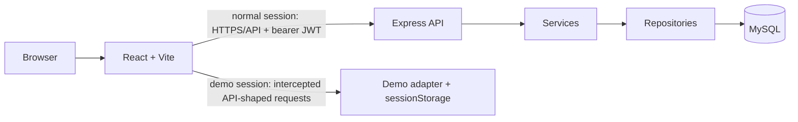

# Application architecture

## Scope and status

This describes the current application architecture.

## Runtime components

| Component | Responsibility | Repository location |
|---|---|---|
| React application | Pages, forms, charts, browser navigation, and client-side session state | `frontend/src/` |
| Express API | Authentication, authorization, validation, and HTTP endpoints | `backend/src/` |
| MySQL database | Persistent users, transactions, categories, budgets, goals, scenarios, and related records | `backend/config/schema.sql` |
| Demo adapter | In-browser implementation of supported API routes for sample data | `frontend/src/demo/demoStore.js` |

The frontend communicates with the API through Axios clients configured by `VITE_API_URL`. Finance endpoints require a JWT bearer token. Controllers call service modules, which apply business rules and call repositories that execute MySQL queries.

The editable diagram is [FinanceManager.mmd](diagrams/FinanceManager.mmd).

## Current hosted topology

The frontend is hosted separately from the Express API and MySQL database. The API's allowed CORS origins include the public frontend and local Vite development (`http://localhost:5173`). The backend connects to MySQL using the `MYSQL*` environment variables. Local startup and environment configuration are described in [Deployment and operations](Deployment.md).

## Normal request flow

1. The browser loads the React app.
2. The frontend reads the API base URL from `VITE_API_URL`.
3. An authenticated API client attaches `Authorization: Bearer <token>` from browser storage.
4. Express verifies the token and attaches the user ID to the request.
5. A route invokes a controller, service, and repository.
6. The API returns JSON; the frontend context or page updates its state and renders the result.

The root API route (`GET /`) performs `SELECT 1` and reports whether the database connection is available. It is a readiness-style check, not an independent process-only liveness check.

## Authentication and ownership

Password login returns a user and JWT. Google login redirects through the API and returns to the frontend OAuth callback. Protected API routes use the user ID from the verified token when reading or mutating user-owned records. OAuth accounts are stored separately from password credentials.

## Demo request flow

Opening `/demo` initializes a sample profile and navigates to the dashboard. While demo mode is active, the Axios adapter handles supported API calls locally and persists changes in the current tab's `sessionStorage`. It does not send those calls to Express. The normal React screens are reused. Unsupported account-management routes are unavailable in demo mode; Settings is also guarded from demo access.

See [Authentication and demo](AuthenticationAndDemo.md) for session behavior and supported routes.

## State boundaries

- Persisted application records live in MySQL in a normal account.
- The frontend Finance context holds fetched application data for the current page session and refreshes it after mutations.
- Scenario changes are persisted as scenario records; scenario projections are calculated when requested.
- Demo records and edits are synthetic and tab-session-local; they do not enter MySQL.
- Goal chart visibility is frontend presentation state keyed by goal ID; priority order is persisted in the database.

## Related documents

- [Database design](DatabaseDesign.md)
- [API reference](APIReference.md)
- [Deployment and operations](Deployment.md)
